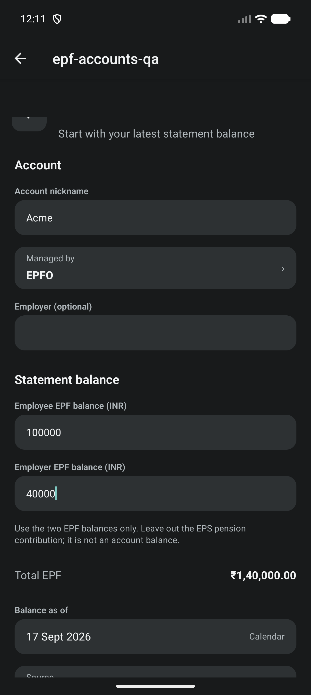
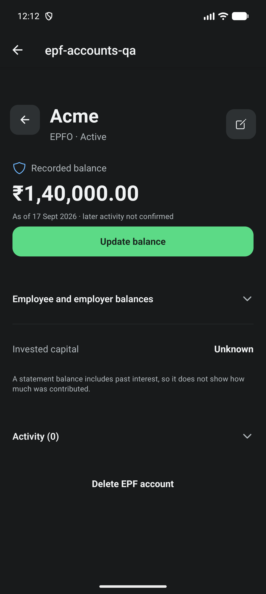
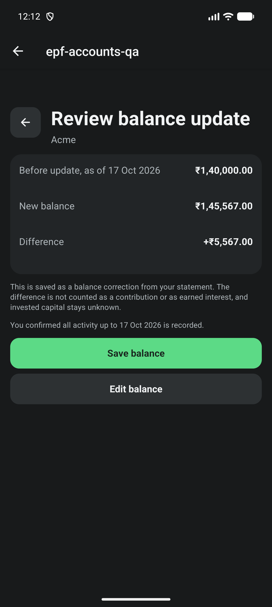

# EPF account setup, detail and balance updates

Related to #546 (first of two PRs) and #542. Owner-approved plan: PR A ships
entry points, add/edit, account detail, Update balance, delete and the legacy
holding link; PR B adds optional contribution, interest, withdrawal, transfer
and reversal entries and closes #546. Invested capital stays unknown at setup
by owner decision; no capital field is offered.

## Implemented

- Holdings: Market · PPF · EPF destinations, shown only when populated, with
  swipe moving one step. EPF section shows the recorded total in Debt and
  compact rows (nickname, employer or provider, non-active status, value,
  as-of date). Add menu gains Add EPF account. Dashboard EPF card opens the EPF
  destination and no longer claims EPF is absent from Progress.
- Add/edit: nickname, EPFO or employer trust, optional employer, employee and
  employer statement balances with a live total, balance date, source, EPS
  exclusion note beside the inputs and a passbook help link. Review before
  save, field-focused errors that keep the draft, Android back discard
  confirmation, masked-value reveal before editing, one command ID per review.
- Detail: total and as-of date first; Update balance as the main action; split,
  activity and unknown invested capital as secondary disclosures; non-active
  accounts keep their value.
- Update balance: prior, new and difference reviewed and saved as an explained
  reconciliation, never a contribution or return. Optional "All activity up to
  this date is recorded" sets history coverage used by Progress.
- Legacy link picker limited to INR debt/other holdings, with confirmation.
- Delete shows entry and linked Cash impact; blocked while a transfer involves
  another tracked account. Entries are removed one validated command at a time
  (idempotent IDs), then the account.

## Verification

- `npm run test:verify`: TypeScript, 209 suites / 2197 tests passed (one suite /
  three tests skipped, unchanged), Expo doctor 17/17.
- `e2e/epf-accounts.yaml` passed: real Add, Detail and Update screens on an
  isolated synthetic MMKV database; exact form, review and detail amounts;
  difference `+₹5,567.00`; a fresh store re-reads persisted records (EPF
  145567, capital unknown, one reconciliation, three audit commands, no Cash);
  database cleared afterwards. Default app data was not touched.
- Device: AVD `CogVest_UX_Proof`, API 36, 1280x2856, 480 dpi, font scale 1.0,
  dark theme, debug development client with branch JavaScript via Metro. Not a
  fresh APK or signed release.
- Screenshot review found clipped comma descenders in the 34sp detail balance
  (rendered as `₹1.40.000.00`); fixed with a matching line height and re-run.

## Gaps and follow-ups

- Holdings EPF tab, light theme, Minimal Mode and large text were not
  screenshot-checked on device; component tests cover states and masking.
  Full matrix belongs to #547.
- Pre-existing, not EPF: `PpfAccountScreen` uses the same 34sp balance style
  without a line height and likely clips commas the same way.
- Account deletion with many entries is a sequence of individually valid
  commands, not one atomic write; an interruption leaves a valid partial state
  that a retry completes.
