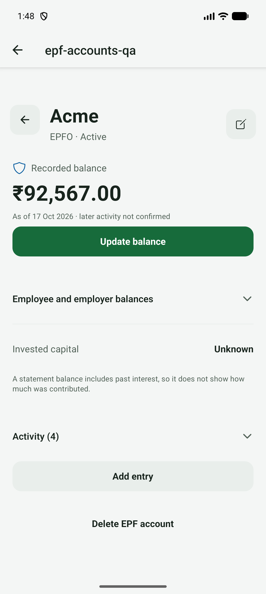
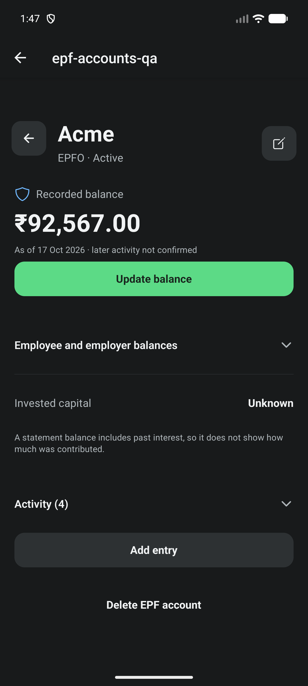
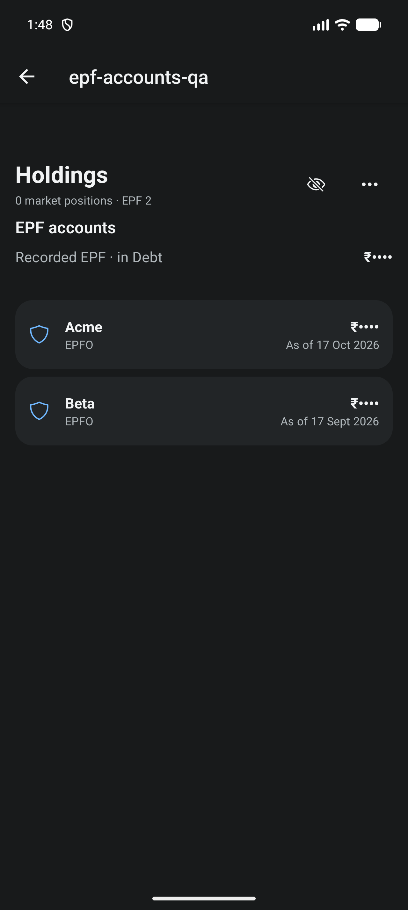
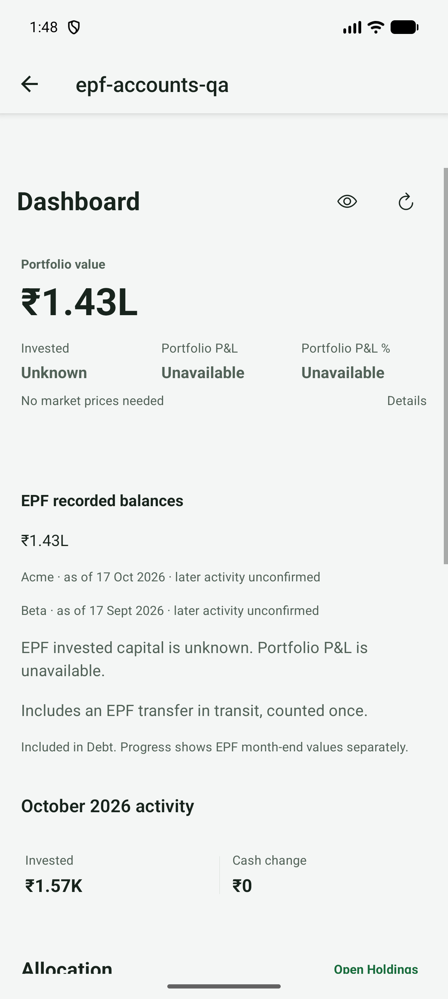
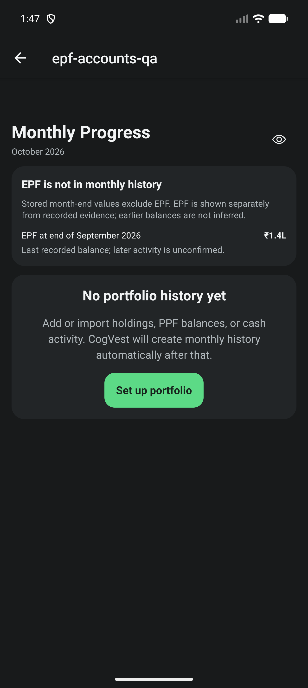
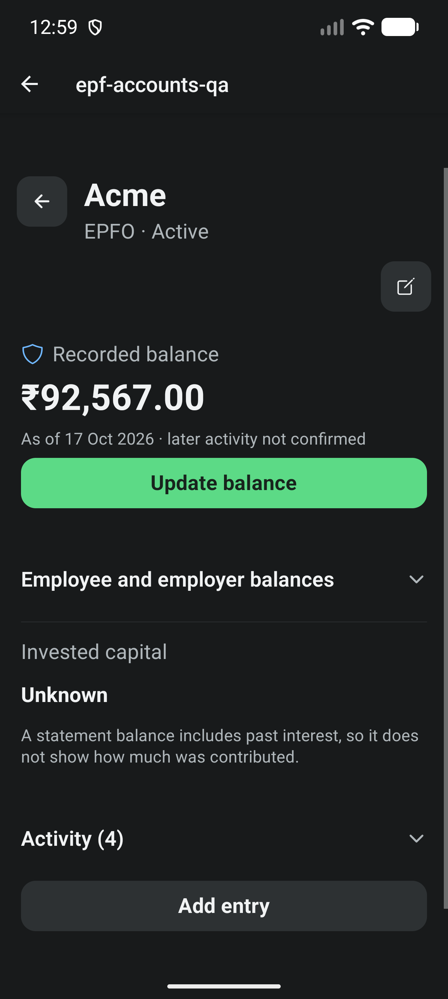
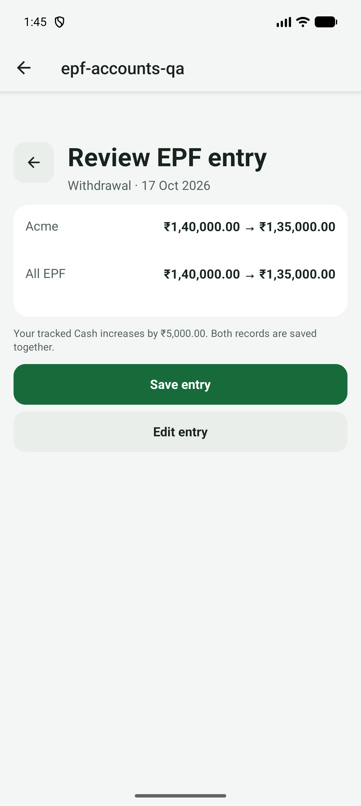

# EPF final verification

Completes #547, the last required child of tracker #542 (after #543-#546).

## Build and device

- Branch `test/547-epf-verification` from `main` at 3ba7643 (#553 merged).
- Fresh local debug APK from `npm run android:apk:emulator` (x86_64), version
  1.0.24 (25), SHA-256
  `cb8ecda062acfb95a0ddfc9d07ae705e1037cf48829fdd18558646f3d60c48bc`,
  installed with `adb install -r`. JavaScript is served by Metro, so this is
  a debug development client, not a signed preview or release build. No cloud
  build was triggered and no physical phone was used.
- AVD `CogVest_UX_Proof`, API 36, 1280x2856, 480 dpi, font scale 1.0 (1.3
  for the large-text pass). The owner declared this emulator disposable for
  #547; every EPF flow uses an isolated synthetic MMKV database and clears it
  at the end.
- Mid-run the AVD was retuned for reliable Maestro runs: RAM 2 GB to 4 GB,
  `hw.gpu.mode=host` (was software rendering), and stylus handwriting off
  (Gboard's "Try out your stylus" sheet was covering text fields). Animations
  stay at 1x: turning them off makes Reanimated raise a development warning
  banner that covers the tab bar. Results below are from the retuned AVD.

## Checks

- `npm run test:v1:pc`: TypeScript, 211 suites / 2212 tests passed (one suite /
  three tests skipped, unchanged), Expo doctor 17/17, Android doctor and strict
  installed-package smoke check.
- EPF Maestro flows, all passing: `epf-persistence`, `epf-reporting`,
  `epf-accounts`, `epf-entries`, `epf-corrections`, `epf-matrix`, and
  `e2e/visual/epf-large-text.yaml` (font scale 1.3, outside the default
  suite).

## Numeric and recovery scenarios

| Scenario | Evidence |
| --- | --- |
| 100,000 employee + 40,000 employer = 140,000 EPF in Debt once, EPS excluded | `epf-accounts`: setup review and detail show 1,40,000; after a statement update the re-read raw record is EPF 145,567, capital unknown, 1 reconciliation, audit 3; `epf-reporting`: 1,40,000 sits in Debt once (Debt 100.00%) |
| 1,200 + 367 contributions then 1,000 interest = 142,567, different capital roles | `epf-entries` review previews and persisted ledger re-read; `epfEntryForm.test.ts` |
| 50,000 between tracked accounts: combined value and capital unchanged, retry no duplicate | `epf-entries`: EPF 142,567, Acme 92,567, Beta 0, 50,000 moving; `epfPersistence.test.ts` repeats no command after restart |
| Snapshot-only baseline claims no lifetime principal or XIRR | `epf-reporting`: invested shown as Unknown; `EpfHistoryScope` and XIRR gap tests |
| Reconcile, correct/delete, withdrawal, cancelled draft | `epf-accounts` balance update; `epf-corrections`: withdrawal 5,000 into Cash gives EPF 135,000, Cash 5,000, one link; deleting it restores EPF 140,000, Cash 0, no links; a cancelled draft saves nothing |
| In-transit transfer and missing history do not create wealth or rebuild loops | in-transit counted once above; `epf-reporting`: EPF stays out of stored monthly history and September 2026 shows "Last recorded balance; later activity is unconfirmed." |
| Restart, backup/restore, malformed restore | `epf-persistence`: cold restart preserves exact records, native restore of EPF 135,000 / Cash 7,000 / audit 2, corrupt restore blocked; seven malformed-restore cases in `epfPersistence.test.ts` |
| Test data removed safely | each EPF flow clears its isolated database and asserts it |

## Appearance, masking and text size

`epf-matrix` renders account detail, Holdings (EPF tab), Dashboard and
Progress under light/standard/shown, light/minimal/masked,
dark/standard/shown and dark/minimal/masked. Money values are readable and
explicit in INR, masking hides every EPF amount, and nothing clips at font
scale 1.3.

The pass also found and fixed one defect: the Dashboard EPF line showed only
the date. It now names the account and says when later activity is
unconfirmed ("EPF · as of 01 Jan 2026 · later activity unconfirmed").

## Regression suite

The full default Maestro suite was run one flow at a time. Every EPF flow and
the PPF, Cash, Futures and import flows that still match today's screens pass.
The other failures are not from EPF work; this branch only changes the EPF QA
route, EPF flows and one Dashboard label. They split into:

- Stale flows written before later screen changes: `dashboard-valuation-basis`
  (subtitle removed in 834eb7f), `add-holding-lookup` (result label changed in
  416e124), `quick-portfolio-setup` (copy simplified in 1969bac),
  `add-holding-asset-class` (Holdings row layout), `add-trade` and
  `add-holding-asset-switch` (conviction now below the optional-context note,
  a6b01fb), `trade-correction` and `asset-correction` (new "Add or update an
  investment" chooser, 24dffaf), `add-holding-pending-valuation`.
- Environment: the Android file picker reopening in a remembered folder for
  `holdings-csv-import` and `zerodha-tradebook-import`, and Gboard's stylus
  sheet before it was disabled.

These flows are being brought up to date in a separate PR so this one stays
EPF-only.

## Gaps

- Not checked on a signed preview or a physical phone; this evidence is from
  a Metro-backed debug build.
- Progress with an EPF-only portfolio still shows the generic "No portfolio
  history yet" empty state instead of pointing to EPF history.
- Full TalkBack and live-font (#529) checks stay out of scope, as the issue
  says.
