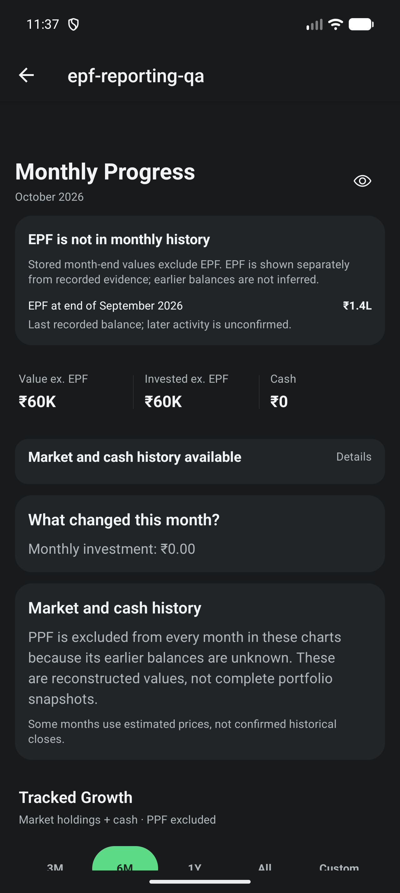

# EPF history scope, legacy links and XIRR boundary

Closes the remaining #545 scope listed in
`2026-10-05-epf-current-reporting.md`. Parent tracker #542 stays open for #546
and #547. Behavior contract: `docs/epf-accounting-contract.md`, "Reporting and
history scope (#545)".

## Decisions (owner-approved 2026-10-17)

- EPF month-end values are derived on demand, not stored in `MonthlySnapshot`.
  Stored snapshots stay EPF-excluded and are never rewritten, so missing EPF
  evidence cannot erase market history or trigger a rebuild.
- Legacy EPF-like holdings link only through an explicit optional
  `legacyAssetId` on the EPF account. Schema 16 is unreleased, so no version
  bump. The link editor ships with #546.

## Implemented

- `buildEpfMonthlyHistory`: completed months from the first checkpoint only;
  `confirmed`, `lastRecorded` or `partial` (total unavailable, never zero);
  contributions, interest, withdrawals and reconciliation reported separately;
  tracked transfers never a flow; in-transit money disclosed; delayed interest
  uses its evidenced effective month.
- Progress shows the selected month's EPF value beside the "ex. EPF" history,
  masked, and "Unavailable" for months before any checkpoint.
- Legacy links validated on every store write and on load/restore; a linked
  holding cannot be deleted or retyped/converted to another currency. From the
  checkpoint date it is replaced in Dashboard, Quick Setup and CSV import
  totals; Holdings and stored snapshots keep it because they exclude EPF.
- XIRR history audit reports EPF accounts, effective events and EPF-linked Cash
  as `epf-history-and-boundary` instead of omitting them or reading deposits.
- Secondary-screen audit: the holdings CSV import "Portfolio after import"
  summary now uses the Dashboard EPF scope with "Unknown" invested capital.
  Holdings (market and PPF scope, labelled), Insights and Settings show no
  whole-portfolio totals and needed no change. Backup preview already counts
  EPF records.

## Verification

- `npm run test:verify`: TypeScript, 206 Jest suites / 2172 tests passed, one
  suite / three tests skipped (unchanged), Expo doctor 17/17. Affected suites
  and `tsc --noEmit` re-run after the final asset-correction guard.
- `npm run maestro:test -- e2e/epf-reporting.yaml` passed, extended with the
  Progress month card: "EPF at end of September 2026", exact `₹1,40,000.00`
  on `progress-epf-month-value`, and the last-recorded status.
- First Maestro attempt failed environmentally: the cold Metro bundle was still
  loading when the 120 s launch wait expired. Pre-bundling and re-running passed
  without flow or app changes.
- Device: AVD `CogVest_UX_Proof`, API 36, 1280x2856, 480 dpi, font scale 1.0,
  dark theme. Installed package `com.abdulshaikh.cogvest` 1.0.24 (25), the
  2026-10-05 debug development client; branch JavaScript served by Metro at
  commit `78c56d7`. Native code is unchanged by this work. This is not a fresh
  APK or signed-release test.

## Gaps and follow-ups

- No light-theme, Minimal Mode or large-font screenshot of the new card; those
  belong to #547's full matrix. Component tests cover masking and states.
- `buildEpfMonthlyHistory` replays the ledger once per month. Fine for manual
  entry volumes; revisit if statement import (#548) brings thousands of events.
- Pre-existing, not EPF: the CSV import summary still excludes Futures equity
  that Dashboard includes.
