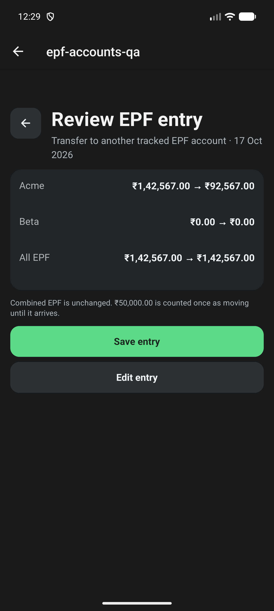
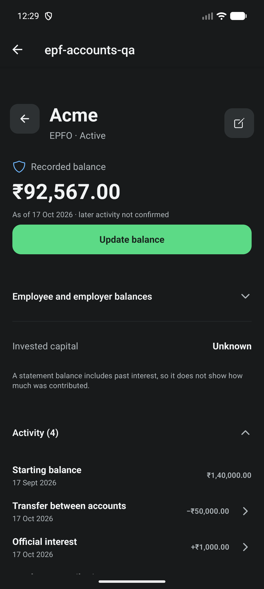

# EPF optional ledger entries

Completes #546 (second PR after #552). Parent tracker #542 stays open for #547.

## Implemented

- Entry screen for employee contributions (voluntary PF toggle), employer
  contributions, official interest with separate period-end and credited
  dates, withdrawals (paid out, unknown destination, or into tracked Cash as
  one atomic pair), transfers to another tracked EPF account (arrived with a
  credit date, or still moving), and transfers in from untracked accounts.
- Optional employee/employer split for aggregate entries; leaving both blank is
  explicit and makes the split unknown until the next balance update.
- Review shows each affected account before and after, all-EPF before and
  after, and the entry's role: contributions are capital, interest is return,
  transfers leave combined EPF unchanged with money in transit counted once.
- Editing keeps entry identity; a transfer is always edited from its source
  account, whichever account opened it. Deleting explains linked Cash and
  two-account effects. "Provider reversed this" records an evidenced reversal
  and keeps the original. Balance updates and reversals are delete-only here.
- Account activity lists signed amounts (masked when values are hidden) and
  opens each entry; Add entry sits with the activity list.

## Verification

- `npm run test:verify`: TypeScript, 211 suites / 2212 tests passed (one suite /
  three tests skipped, unchanged), Expo doctor 17/17.
- `e2e/epf-entries.yaml` passed on an isolated synthetic MMKV database:
  1,200 employee + 367 employer + 1,000 interest = 142,567; a 50,000 transfer
  in transit leaves all EPF at 142,567 with Acme 92,567 and Beta 0. A fresh
  store re-read the persisted ledger exactly (no Cash change) before the
  database was cleared. `e2e/epf-accounts.yaml` still passes.
- AVD `CogVest_UX_Proof`, API 36, 1280x2856, 480 dpi, font scale 1.0, dark;
  debug development client via Metro, not a fresh APK or signed release.

## Gaps

- Light theme, Minimal Mode and large text not screenshot-checked on device;
  belongs to #547 with the full numeric and recovery matrix.
- Cash-linked employee contributions are supported by the domain but not
  offered in the form; payroll contributions do not pass through tracked Cash.
