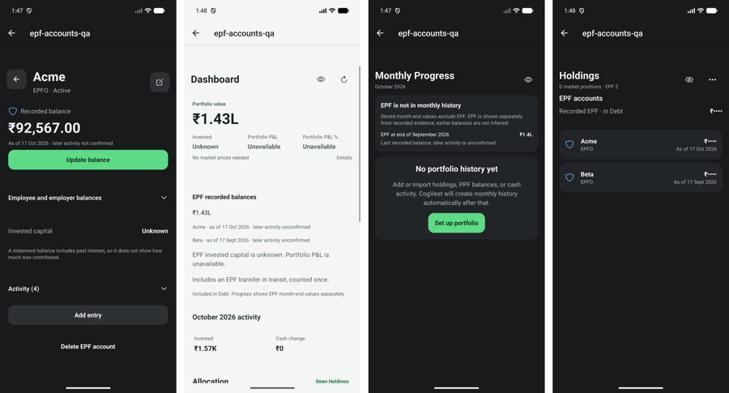
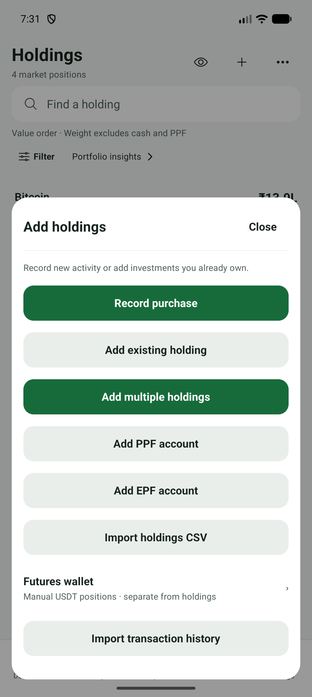
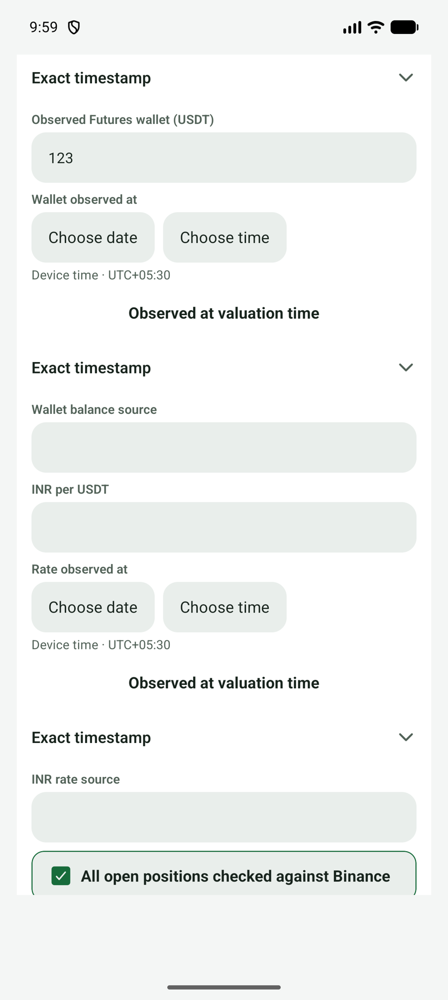
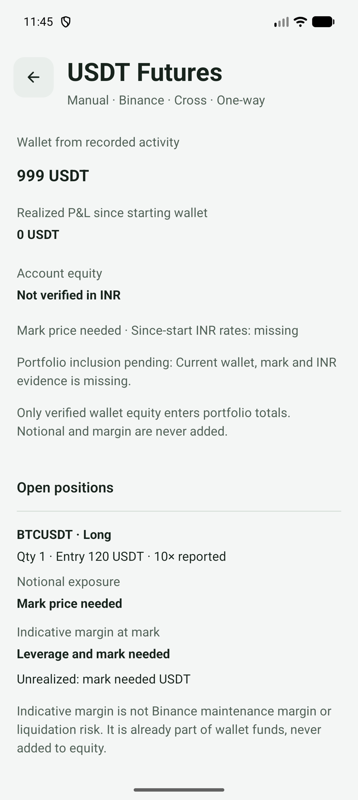

# Design Assessment (2026-10-18)

A whole-app visual and interaction review, used as the starting point for design planning. It records findings and directions. It changes no code, and it does not decide anything until a direction is chosen.

Related: #557, the quality tracker for testing, code structure and UI density. Its design child #562 covers the Add holdings sheet, the Futures valuation form and a copy budget. This review is broader and should shape the design plan that #562 belongs to.

## Basis

- `DESIGN.md` as the yardstick.
- About 25 screens on the reference emulator (`CogVest_UX_Proof`, API 36, 1280x2856, 480 dpi), captured during #547 verification and the #556 Maestro refresh, in Standard and Minimal modes, dark and light, masked and unmasked. The screens are Dashboard, Holdings, Holding details, the Add holdings sheet, Add Holding, Cash, Progress and monthly history, Settings, the transaction and CAS import review, Futures, and the EPF account and reporting screens.
- No user research or analytics; these are expert-review findings.

## Summary

The foundation is solid but under-delivered. `DESIGN.md` asks for a calm, premium experience with "Linear/Wise/Stripe-like" precision. The app as shipped is correct, consistent and honest, but it reads more like a well-organised document than a premium product.

## What is already good

- **`DESIGN.md` is mature:**
  - semantic tokens;
  - a 4.5:1 contrast floor;
  - 48dp touch targets;
  - Minimal Mode rules;
  - the screen model "answer first, evidence second, action last".
- **The palette is restrained:** neutral graphite and soft light surfaces with a single green.
- **Masking is consistent everywhere** (`₹••••`) and keeps layouts stable.
- **States are honest.** Unknown values, stale quotes and unconfirmed balances are never faked. Keep this.
- **The hero values are confident**, for example ₹92,567.00 on an EPF account and ₹15.9L on the Dashboard.

## Findings

### 1. Screens explain themselves in sentences instead of showing state (highest impact)
Status and limitations are written out as paragraphs of grey prose. For example, the light-mode Dashboard's EPF section stacks six lines:
- "EPF invested capital is unknown. Portfolio P&L is unavailable."
- "Includes an EPF transfer in transit, counted once."
- "Included in Debt. Progress shows EPF month-end values separately."

The EPF detail, Futures and import review screens follow the same pattern. Every sentence is true, but together they turn screens into reading.

- **Direction:** a status-chip and info-sheet system. Short chips such as "Recorded · 17 Oct", "Unconfirmed" or "In Debt", a small ⓘ icon, and a details sheet holding the full explanation. Honesty is kept; it just moves out of the main reading path.

### 2. Hierarchy below the hero value is flat
Section titles, labels, values and explanations sit at similar sizes and weights, so the eye has nowhere to land after the main number.

- **Direction:** a tighter type scale (fewer sizes, clearer steps) and stronger contrast between the value, label and caption levels.

### 3. Dead metrics hold prime positions
When values are unknown, the Dashboard's best row reads "Invested **Unknown** · Portfolio P&L **Unavailable** · P&L % **Unavailable**". Three metric slots show nothing.

- **Direction:** collapse the row into one quiet line, such as "Returns unavailable: invested capital unknown ⓘ", and give the space back to useful content.

### 4. Primary buttons are too loud, especially in dark mode
Full-width bright `#5CDA86` bars are often the brightest element on screen. Examples: "Update balance", "Save valuation", "Confirm transaction import", "Set up portfolio". That conflicts with "green is an accent, not decoration". The Add holdings sheet even shows two filled green buttons together.

- **Direction:** an action-weight hierarchy.
  - Tonal or outlined actions by default.
  - The bright filled bar only for the final commit of a money-changing flow.
  - Never two filled primaries in the same view.

### 5. Little visual identity in the data
Holdings rows are text plus a thin weight bar. Each asset class gets a colour only inside the allocation bars (Equity green, Debt blue, Crypto gold). EPF rows use a shield icon, which reads as "security". The Dashboard has no trend at all.

- **Direction:**
  - A consistent colour and icon per asset class, reused in Holdings rows, Dashboard allocation, Progress breakdowns and detail headers. That makes screens scannable and gives the app its own character without adding noise.
  - One small, calm portfolio trend on the Dashboard, built from stored month-ends rather than live prices, in line with the long-term, not-a-trading-floor brief.

### 6. Uneven spacing rhythm; light mode is flat
Content is dense near the top, then there is a large empty area below (Holdings, Cash, Progress). In light mode, white "section" surfaces on `#F4F6F5` barely separate, so long screens become one continuous column of text.

- **Direction:** a deliberate vertical rhythm, with consistent section gaps and clearer grouping. In light mode, add a little more surface separation, or use hairline grouping, so sections read as distinct units.

### 7. Forms are long and repetitive
Add Holding's position step, Cash entry and especially Futures valuation stack many full-width fields with helper captions. Futures valuation repeats its "date / time / device time / observed at / exact timestamp / source" block three times.

- **Direction:** already in #562: one shared "observed at" time, condensed helper text, and progressive disclosure.

## Proposed directions to plan
1. **A status-chip and info-sheet system** to replace explanatory prose (findings 1 and 3).
2. **A tightened type scale and spacing rhythm**, including light-mode separation (findings 2 and 6).
3. **Asset-class colour and icon identity** as the app's visual signature (finding 5).
4. **An action-weight hierarchy:** tonal by default, filled bright only for the final money-changing commit (finding 4).
5. **A redesigned Dashboard** that brings 1–4 together: hero value, one calm trend, allocation with class identity, and status chips (findings 1, 3, 4 and 5).
6. **Form simplification**, already tracked in #562 (finding 7).

## Suggested next step
Directions like these are easier to judge than to describe. Before writing issues, build a clickable HTML prototype with 2–3 distinct directions for the Dashboard, Holdings and an account detail screen. It should use the real `src/theme/palettes.ts` tokens and fake data, in dark and light. Pick one direction, update `DESIGN.md` where it changes the rules (chips, action weights, class colours), then split the work into a design tracker with concrete child issues.

## Constraints any direction must keep
- No change to financial calculations, records or routes (DESIGN.md §1).
- Every limitation, provenance and not-advice statement stays reachable; it can only be condensed or moved behind disclosure.
- Masking, Minimal Mode, the contrast floor, large text and 48dp targets still hold.
- Gains and losses never rely on colour alone.
